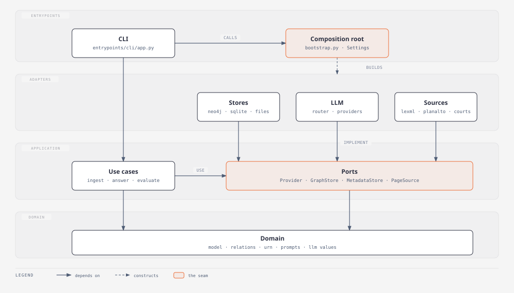
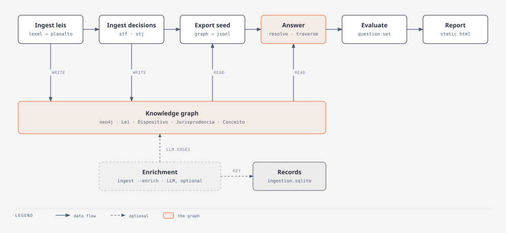
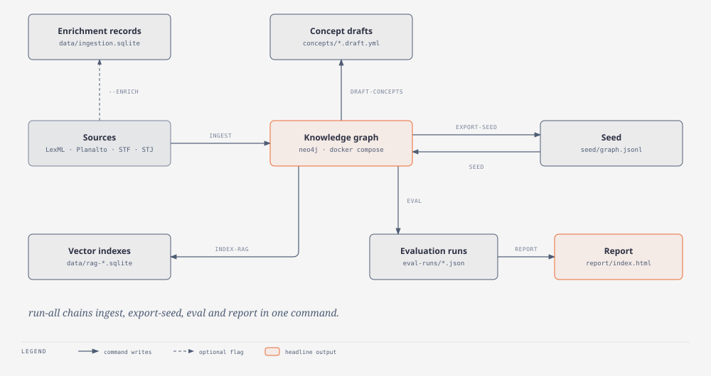
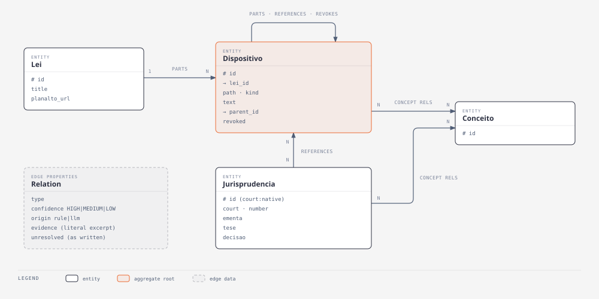

# Architecture

`legal_radar` is one bounded context organised in four layers, with dependencies pointing
inward only. The decision and its alternatives are in
[ADR-0009](docs/adr/0009-layered-architecture-enforced-by-import-linter.md); the vocabulary
(lei, dispositivo, assunto, conceito...) is in [CONTEXT.md](CONTEXT.md).

## Layers

| Layer | Holds | May import |
|---|---|---|
| `domain/` | The model (`Lei`, `Dispositivo`, `Relation`...), the rule-based relation extraction, URN and prompt-lock values, LLM value types, the complexity classifier and the anchor leis. Pure: no I/O, no framework. | itself |
| `application/` | The use cases (ingest, enrich, answer, evaluate, RAG baselines) and the **ports** they need, as small `Protocol`s in `application/ports/`. | `domain` |
| `adapters/` | Everything that touches the outside: Neo4j, SQLite, the LLM providers and router, LexML, Planalto, STF, STJ, LangSmith, the assayer harness and the prompt lock file. Each implements a port or wraps a library. | `application`, `domain` |
| `entrypoints/` | The CLI and the end-to-end run, which compose concrete adapters. | everything |

`bootstrap.py` is the **composition root**: the only module that reads the environment
(`.env`, `NEO4J_*`, `METADATA_DB`...) and builds concrete adapters. `settings.py` holds every
path and environment-derived value in one frozen `Settings`; defaults match a source checkout.

## The dependency rule is enforced

`import-linter` runs in CI (`uv run lint-imports`, configured in `pyproject.toml`) with two
contracts:

1. **Layers point inward**: `entrypoints > adapters > application > domain`.
2. **The domain stays free of infrastructure**: it may not import `neo4j`, `bs4`, `sqlite3`,
   `langsmith`, `playwright`, `langgraph`, `yaml` or `jsonschema`.

A broken contract fails the build. The `ignore_imports` list in `pyproject.toml` is the known
debt (below); it only shrinks.

## Where things go

- A new **rule or value** that needs no I/O: `domain/`.
- A new **use case**: `application/`, taking its collaborators as ports. If it needs something
  external, add a `Protocol` to `application/ports/` and implement it in `adapters/`.
- A new **source, store or provider**: `adapters/`, behind an existing or new port.
- A new **command**: a function in `entrypoints/cli/app.py`, registered in `OFFLINE` or `ONLINE`,
  with whatever it needs built in `bootstrap.py`.
- A new **path or env variable**: a field on `Settings`, never `Path(__file__)` in a module.
- Tests mirror the layers: `tests/domain`, `tests/application`, `tests/adapters`,
  `tests/entrypoints`.

## What the system produces

The graph is the core artifact; every other output is derived from it.

The graph itself has a small model, with every edge carrying its confidence and origin
(ADR-0002):

The same diagrams are available as standalone HTML in [docs/diagrams/](docs/diagrams/).

## Known debt

Recorded as `ignore_imports` in `pyproject.toml`, to be removed one by one:

- **Default prompt lock.** The use cases default to `adapters.prompt_lock.default_lock()` when no
  lock is passed. The fix is to inject the lock from `bootstrap.py` and drop the defaults.
- **`ingest` calls LexML and Planalto directly.** It should depend on two ports (a lei locator
  and a lei text source) with the LexML and Planalto adapters behind them.
- **RAG index in SQLite.** `application/rag.py` talks to `sqlite3` directly; it should use a
  vector-store port like the enrichment records do.
