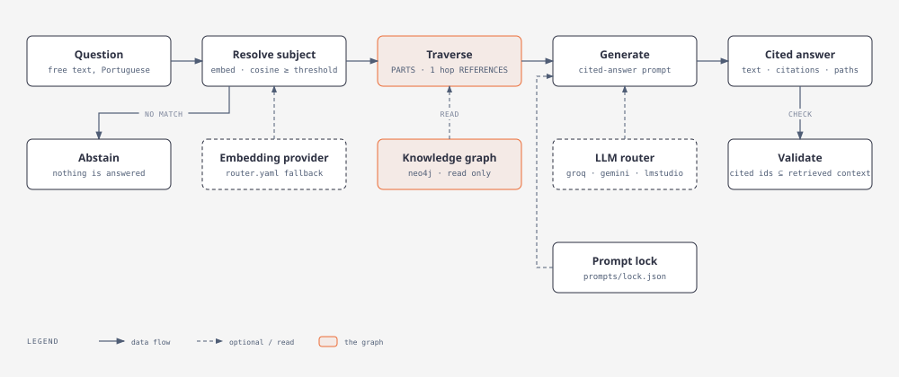

<a id="readme-top"></a>

<!-- Structure adapted from https://github.com/othneildrew/Best-README-Template -->

<br />
<div align="center">
  <h3 align="center">Legal Radar</h3>

  <p align="center">
    A graph-RAG system over Brazilian law: given a legal subject, it links the statute,
    the court decisions and the legal concepts that bear on it, and answers questions with
    citations you can trace back to the graph.
    <br />
    <a href="ARCHITECTURE.md"><strong>Explore the architecture »</strong></a>
    &middot;
    <a href="https://emvalencaf.github.io/legal-radar/">Live report</a>
    &middot;
    <a href="https://emvalencaf.github.io/legal-radar/graph.html">Graph sample</a>
    <br />
    <br />
    <a href="https://github.com/emvalencaf/legal-radar/issues/new">Report Bug</a>
    &middot;
    <a href="https://github.com/emvalencaf/legal-radar/issues/new">Request Feature</a>
  </p>
</div>

<details>
  <summary>Table of Contents</summary>
  <ol>
    <li>
      <a href="#about-the-project">About The Project</a>
      <ul>
        <li><a href="#does-the-graph-help">Does the graph help?</a></li>
        <li><a href="#design-decisions">Design decisions</a></li>
        <li><a href="#domain-terms">Domain terms</a></li>
        <li><a href="#built-with">Built With</a></li>
      </ul>
    </li>
    <li>
      <a href="#getting-started">Getting Started</a>
      <ul>
        <li><a href="#prerequisites">Prerequisites</a></li>
        <li><a href="#installation">Installation</a></li>
      </ul>
    </li>
    <li><a href="#usage">Usage</a></li>
    <li><a href="#roadmap">Roadmap</a></li>
    <li><a href="#contributing">Contributing</a></li>
    <li><a href="#license">License</a></li>
    <li><a href="#contact">Contact</a></li>
    <li><a href="#acknowledgments">Acknowledgments</a></li>
  </ol>
</details>

## About The Project

Legal questions rarely live in one place: a provision of the Civil Code is interpreted by
court decisions, qualified by other statutes and shaped by legal concepts. Plain vector search
over the text finds *similar* passages but not *related* ones. Legal Radar builds a knowledge
graph over the Brazilian legal sources ([LexML](https://www.lexml.gov.br/), Planalto, STF, STJ),
resolves a user's legal subject (*assunto*) to anchor statutes, walks the graph from there and
asks an LLM to answer **only** from what it reached, citing each source.



### Does the graph help?

The graph system is scored against two pure-RAG baselines on the same 50 questions about one
anchor subject (disregard of the corporate entity), so its value is measured, not assumed:

| Metric | Graph | RAG @5 | RAG @15 |
|---|---:|---:|---:|
| Citation correctness | **0.77** | 0.59 | 0.71 |
| Citation recall | **0.91** | 0.61 | 0.74 |
| Fabricated citations | 0.00 | 0.00 | 0.00 |
| Abstention | **0.85** | 0.77 | 0.69 |
| Input tokens per question | 7,418 | 875 | 2,424 |

The graph wins on the harder questions (0.83 on the hardest tier against 0.28 and 0.58, and 0.81
against 0.52 on the middle one) and on recall, but it loses on the easy tier (0.54 against 0.58 and
0.74) and costs about three times the input tokens of the larger RAG baseline. Contradiction
surfacing is low for every system (0.33 at best).

Read the caveats before trusting any number: one subject, one language, one run per system and a
gold set annotated by a single person. An earlier run of the same graph system scored 0.84 with
4,274 input tokens per question; the two runs differ in which provider answered (the router falls back
between Groq and Gemini) and in a re-ingestion of the graph in between, so run-to-run variance is not
separated from real change. See [evaluation/BASELINE.md](evaluation/BASELINE.md) and
`uv run legal-radar compare-evals`; the runs live in `eval-runs/`, which is not versioned, and the
full results are in the [live report](https://emvalencaf.github.io/legal-radar/).

### Design decisions

Each non-obvious choice is recorded as an ADR in [docs/adr/](docs/adr/): why the statute text comes
from Planalto and not LexML (0001), hybrid rule + LLM relation extraction with provenance and
confidence (0002), a concept vocabulary per subject (0003), pinned and versioned prompts (0004),
and a layered architecture whose dependency rule is enforced in CI (0009). The layout and the
diagrams are in [ARCHITECTURE.md](ARCHITECTURE.md).

### Domain terms

The domain is Brazilian law, so the code, prompts and data keep the Portuguese terms on purpose.

| Portuguese | English |
|---|---|
| assunto | legal subject |
| lei | statute |
| dispositivo | provision (article, paragraph, item) |
| jurisprudência | case law |
| doutrina | legal scholarship |
| ementa / acórdão | case summary / appellate ruling |

The full table is in [CONTEXT.md](CONTEXT.md#english-glossary).

<p align="right">(<a href="#readme-top">back to top</a>)</p>

### Built With

* [Python](https://www.python.org) managed with [uv](https://docs.astral.sh/uv/)
* [Neo4j](https://neo4j.com/) for the knowledge graph and [LangGraph](https://langchain-ai.github.io/langgraph/) for the query pipeline
* [LangSmith](https://smith.langchain.com/) for versioned prompts and tracing, [RAGAS](https://docs.ragas.io/) for grounding checks
* Groq, Gemini or a local LM Studio model behind a fallback router (`router.yaml`)
* [ruff](https://docs.astral.sh/ruff/) and [import-linter](https://import-linter.readthedocs.io/) for the standards CI enforces

<p align="right">(<a href="#readme-top">back to top</a>)</p>

## Getting Started

### Prerequisites

<!-- Tools and versions needed before installing. -->

* [`uv`](https://docs.astral.sh/uv/)

### Installation

1. Clone the repository
   ```bash
   git clone https://github.com/emvalencaf/legal-radar.git
   cd legal-radar
   ```
2. Enable the git hooks
   ```bash
   scripts/setup.sh
   ```

<p align="right">(<a href="#readme-top">back to top</a>)</p>

## Usage

Start Neo4j with docker compose and run the pipeline over the fixture lei:

```bash
docker compose up -d neo4j
uv run legal-radar run
```

Ingest the anchor leis of an assunto from LexML/Planalto (needs `uv sync --extra browser` and
`playwright install chromium`, since both sites reject plain HTTP clients):

```bash
uv run legal-radar ingest "desconsideração da personalidade jurídica"
```

Add `--enrich` to also send the chunks the rules left to the LLM (needs the assunto's vocabulary
and a provider in `router.yaml`). Each chunk it sends gets a record in `data/ingestion.sqlite`
(`METADATA_DB` overrides the path); re-running resumes only the chunks that are still `pending`, or
whose text, vocabulary, `dispositivo-enrichment` prompt or extractor version changed.

Ingest an assunto's seed precedents (for the anchor assunto: STJ Tema 1210, STF Tema 1232) and the
top hits of each court's search. The sources are catalogued per assunto in `CASE_LAW`
(`legal_radar.application.case_law`): the seeds, one search per court and the number of top hits (default
5; 0 ingests only the seeds). STJ's Cloudflare check rejects bundled Chromium, so this needs Google
Chrome installed:

```bash
uv run legal-radar ingest-jurisprudencia "desconsideração da personalidade jurídica"
```

Add `--enrich` to also link each decision's ementa and tese to the concepts of the assunto (the
`jurisprudencia-enrichment` prompt, pinned in `prompts/`); re-running only sends the pending
decisions.

Export the graph to the versioned seed (`seed/graph.jsonl`, commit it), or rebuild a fresh
Neo4j from it; loading is MERGE-based, so repeating it changes nothing:

```bash
make export-seed
make seed
```

Prompts (and their structured-output schemas) are pinned to LangSmith Hub commits in
`prompts/pins.yml` and read offline from `prompts/lock.json`; the pipeline and tests need no
LangSmith account or network, only a source checkout. To follow new Hub commits, set
`LANGSMITH_API_KEY`, edit the pins and refresh the lockfile (needs the `prompts` extra):

```bash
make refresh-prompts
```

Score the enrichment (rules and LLM) against a hand-validated gold set: per-edge
precision/recall/F1 split by origin and relation type, the indirect metrics (target-resolved,
valid-evidence and drop rates) and the quality gates in `evaluation.yml`. It exits non-zero when a
gate fails; `--persist DIR` keeps each input and output as JSONL for audit. The gold set format is
documented in `legal_radar.application.evaluation.enrichment_gold.load_gold`.

```bash
uv run scripts/eval_enrichment.py evaluation/enrichment_gold.yml --provider gemini --persist eval-runs
```

Ask a question: resolve the assunto, traverse the graph (`PARTS`, then 1 hop of `REFERENCES`)
and print an answer citing the dispositivos and jurisprudência it used, with their graph paths.
The `cited-answer` prompt must be published to the Hub and pinned first.

```bash
uv run legal-radar ask "pedido de desconsideração da personalidade jurídica"
```

Evaluate the answer pipeline over the question set in `evals/` (needs the graph, the router's
providers and `uv sync --extra eval`). It scores citation correctness, contradiction surfacing and
graph paths, plus RAGAS faithfulness with `--grounding` (judge model from `RAGAS_BASE_URL` and
`RAGAS_MODEL`, `RAGAS_API_KEY`; the endpoint must accept `json_object` output, so not LM Studio),
tracks tokens and cost (`--price-in`/`--price-out`, USD per million) and writes the
result to `eval-runs/`. Questions marked `abstain: true` are ones the graph cannot answer; they are scored
on whether the answer admits it. The `tema-1210` question is parked (commented in `evals/`) until
a decision is linked to the dispositivos it cites: today no jurisprudência has an edge, so the
traversal cannot reach one. RAGAS 0.4 needs a stub for
the `ChatVertexAI` import that langchain-community 0.4 dropped; the harness applies it.

```bash
make eval
```

Measure what the graph adds with the pure-RAG baselines: they embed the whole corpus (every live
dispositivo and decision, not only the anchor subtrees), retrieve the top-k by cosine similarity
and answer with the same `cited-answer` prompt. `naive` indexes each dispositivo's own text;
`contextual` prepends its caput and parent artigo. The vector index of each chunking is built once
(`data/rag-<chunking>.sqlite`, resumable after a quota error) and reused. `graph_path` is n/a for
them.

```bash
uv run legal-radar index-rag contextual                       # optional: build the index ahead
uv run --extra eval legal-radar eval "desconsideração da personalidade jurídica" \
  --baseline rag-contextual --k 5 15                          # likewise rag-naive
uv run legal-radar compare-evals                              # the latest run of each system
```

An interrupted `eval` resumes by default: each answer is saved to `eval-runs/checkpoints/` and
reused on the next run (while the questions and pinned prompts are the same); `--fresh` discards
them. `compare-evals` tables the graph, naive RAG and contextual RAG per metric and, for the main ones,
per `nivel` (the questions without one are `base`); give it run files to compare specific runs.

Generate the static report (ingestion statistics, evaluation results, example answers with their
cited graph paths, `prompt_hash` and run ids; no LangSmith trace links) from the latest runs in
`eval-runs/`, and publish it by hand to GitHub Pages at
<https://emvalencaf.github.io/legal-radar/>. The first time, enable Pages in the repository
settings (source: branch `gh-pages`, folder `/`); no CI is involved. When `seed/graph.jsonl` and an
enrichment run exist, `report/graph.html` also draws a sample of the knowledge graph around the
example answers (offline, works on a phone); without them the report is still built, with a warning
and no link.

```bash
make report            # writes report/index.html and report/graph.html
make publish-report    # builds it and pushes the gh-pages branch
```

Run the whole pipeline over the anchor assunto with one command: it ingests the leis and the
decisions, exports the seed to `seed/graph.jsonl`, answers the assunto as a cited query, scores the
question set (`eval-runs/`) and writes `report/index.html`. It needs Neo4j up
(`docker compose up -d neo4j`), the `browser` and `eval` extras, Google Chrome and the router's
providers. It overwrites `seed/graph.jsonl` with the graph it just built; `--enrich` adds the LLM enrichment of the leis and decisions. The same entrypoint runs in
the test suite over pinned fixtures with the fake provider and a Neo4j container
(`tests/test_end_to_end.py`).

```bash
make run-all
```

Opt-in live smoke test against the real courts (not run by default): `uv run pytest -m live`.

Tests (need Docker for the Neo4j test container): `uv run pytest`.

<p align="right">(<a href="#readme-top">back to top</a>)</p>

## Roadmap

- [ ] A source for *doutrina*, the third pillar of the graph (not chosen yet, see `docs/research/doutrina-source.md`)
- [ ] Legislative amendments and their cascade of affected entities (modelled, not implemented)
- [ ] Link decisions to the provisions they cite, so the parked `tema-1210` question can run
- [ ] Tune the enrichment quality gates from evidence and enable them in CI
- [ ] More than one anchor subject, to measure how the results generalise

See the [open issues](https://github.com/emvalencaf/legal-radar/issues) for proposed features and known issues.

<p align="right">(<a href="#readme-top">back to top</a>)</p>

## Contributing

Contributions follow the branch strategy and commit convention in
[CONTRIBUTING.md](CONTRIBUTING.md): cut a branch from `development`, commit as
`tag(subject/subsubject): summary`, and open a pull request into `development`.
Coding and documentation rules are in [CODE_STANDARDS.md](CODE_STANDARDS.md).

<p align="right">(<a href="#readme-top">back to top</a>)</p>

## License

Distributed under the MIT License. See [LICENSE](LICENSE).

The legislation and court decisions the system ingests are public Brazilian legal texts; the
license covers this project's code, vocabularies and evaluation data, not those sources.

<p align="right">(<a href="#readme-top">back to top</a>)</p>

## Contact

Edson Mota Valença Filho - [@emvalencaf](https://github.com/emvalencaf)

Project Link: [https://github.com/emvalencaf/legal-radar](https://github.com/emvalencaf/legal-radar)

<p align="right">(<a href="#readme-top">back to top</a>)</p>

## Acknowledgments

* [Best-README-Template](https://github.com/othneildrew/Best-README-Template)

<p align="right">(<a href="#readme-top">back to top</a>)</p>
